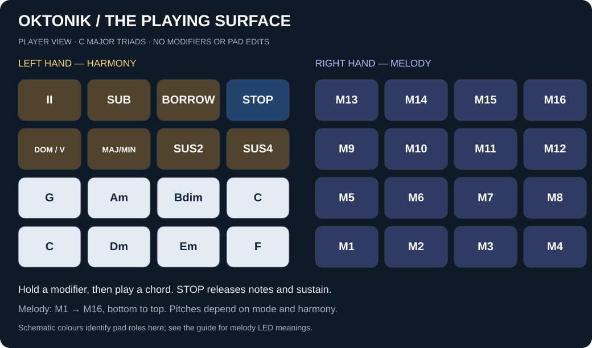
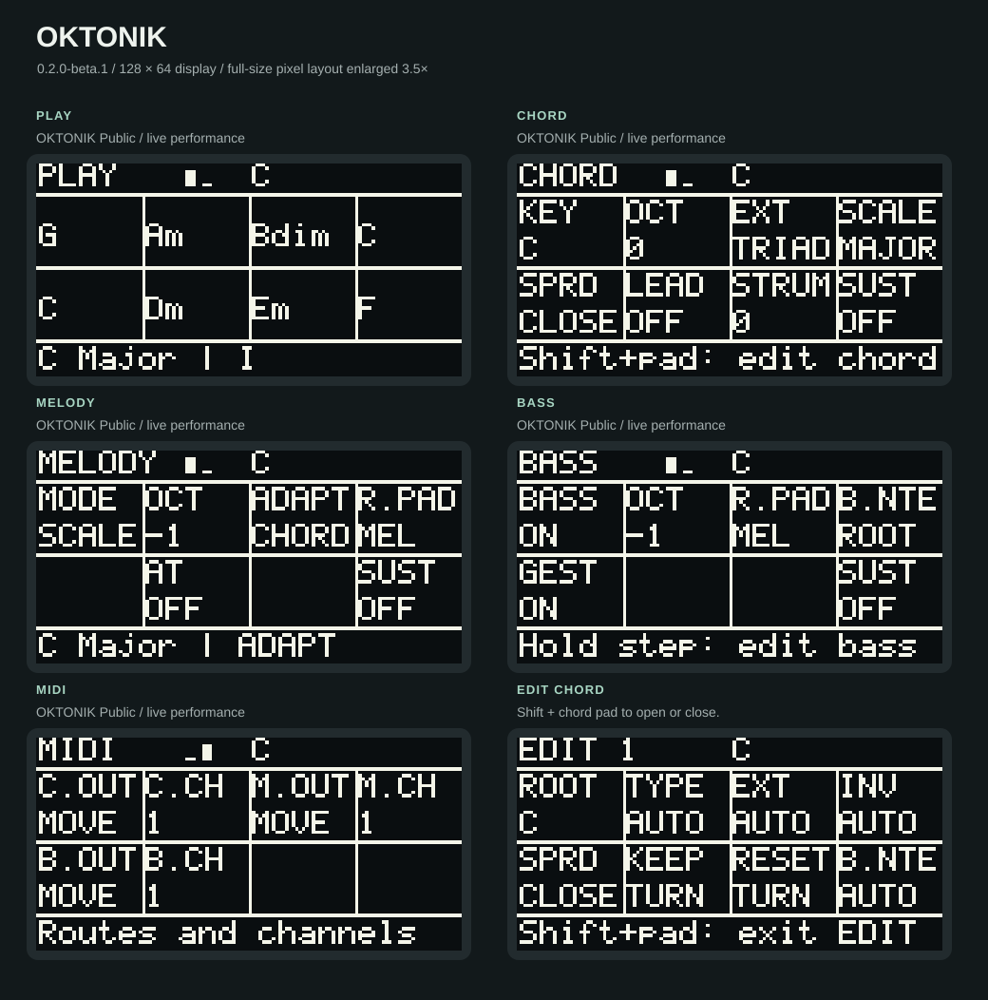
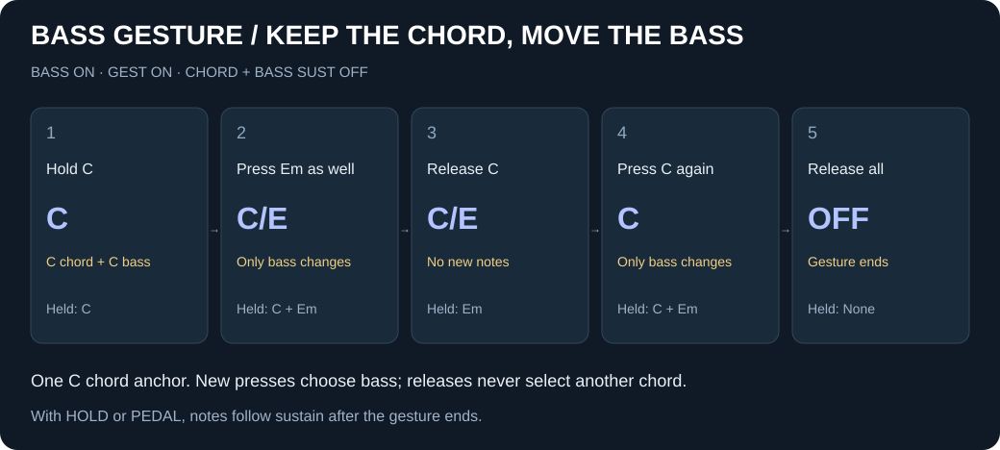
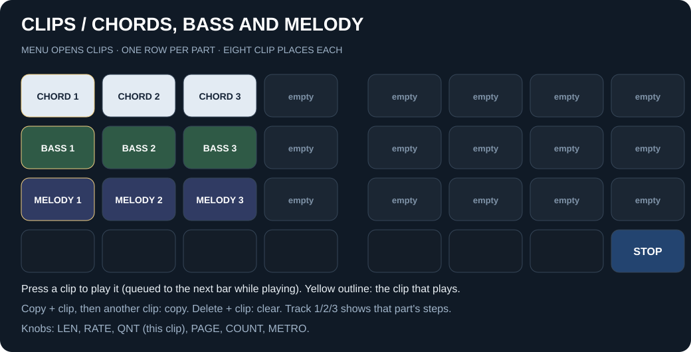
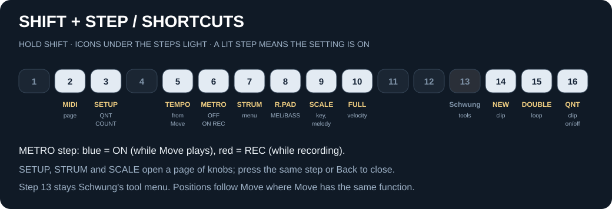
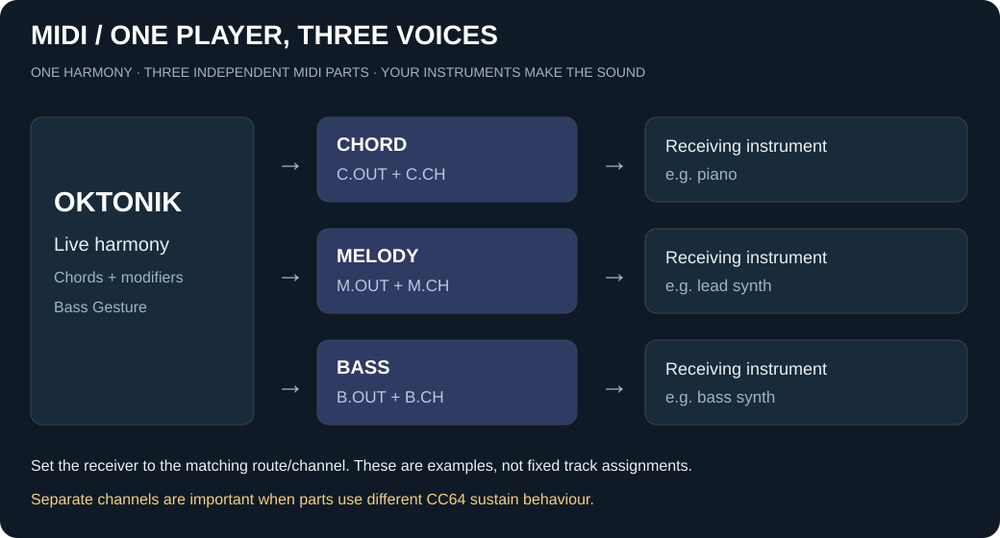

# OKTONIK user guide

**Harmonic performance instrument · by Skerry Vibe**  
For **0.2.0** on Ableton Move / Schwung **1.7.3**.

One player, three musical parts: chords, melody and bass. Play them live,
record them into clips and edit them on the step buttons. OKTONIK generates
MIDI notes; your Move tracks or external instruments provide the sound.

[Published releases](https://github.com/skerryvibe/oktonik/releases) ·
[Report a bug](https://github.com/skerryvibe/oktonik/issues) · [Overview](../README.md)

## Contents

- [Install](#install)
- [Your first jam](#your-first-jam)
- [Learn the pad surface](#learn-the-pad-surface)
- [Find your way around](#find-your-way-around)
- [Chords](#chords)
- [Explore with modifiers](#explore-with-modifiers)
- [Edit one chord](#edit-one-chord)
- [Melody](#melody)
- [Bass](#bass)
- [Record a loop](#record-a-loop)
- [Clips](#clips)
- [Steps](#steps)
- [Shift + step shortcuts](#shift--step-shortcuts)
- [Count-in, metronome and quantize](#count-in-metronome-and-quantize)
- [Sustain and stopping notes](#sustain-and-stopping-notes)
- [Route your instruments](#route-your-instruments)
- [Troubleshooting and saves](#troubleshooting-and-saves)

## Install

1. Install Schwung 1.7.3 on Move. Back up your Move projects.
2. Download **oktonik-module.tar.gz** from the
   [releases page](https://github.com/skerryvibe/oktonik/releases). Do not
   choose GitHub's **Source code** downloads.
3. On the same Wi-Fi, open `move.local:7700` and upload the compressed archive.
4. Restart Move, so that the new version and its audio part are loaded.
5. Open **OKTONIK** from Schwung's tools (Shift + step 13).
6. On OKTONIK's **MIDI** page, match routes and channels to your instruments.

OKTONIK Lab, if installed, is a separate module with its own settings.
Returning to 0.1.0 can lose clips and newer settings; restore a backup instead.

## Your first jam

Start with a piano or another clearly audible instrument. Live chords and
melody need no transport: you do not need to press Play.

1. On **PLAY**, set KEY C, SCALE MAJOR, EXT TRIAD, LEAD OFF, SUST OFF.
2. Play C, F, then G with the lower-left pads. Add a melody with the
   right-hand pads; it follows the harmony.
3. Hold **SUS4**, play C, release both, then play C again. A modifier prepares
   the next chord; pressing it alone changes nothing that already sounds.
4. Bass and bass gesture are on in a new project. Hold C and press Em: only the
   bass moves (C/E). Release all chord pads before the next chord.
5. When you like a progression, [record it](#record-a-loop).

## Learn the pad surface

*Schematic, not a photograph. Chord names show C major triads without edits.
Melody numbers are playing order, not fixed pitches.*

- **Lower-left eight pads:** chords, left to right from the bottom row. The
  upper C repeats the tonic higher up.
- **Upper-left seven pads:** modifiers; each can be reassigned. **STOP**
  (directly above SUS4) is fixed.
- **Sixteen right-hand pads:** melody, ascending from the bottom row, or bass
  when R.PAD is set to BASS.
- **Sixteen step buttons:** the steps of the part you are editing, and Shift
  shortcuts.

PLAY shows the chord pads as a map of chord names. Holding a modifier previews
what each pad would play. The header names the sounding chord; the footer shows
the key and the chord's function, for example `C Major | V`.

## Find your way around

The display has eight cells: knobs 1–4 on the upper row, 5–8 on the lower row.
Touch or turn a knob to see its full name and value in the footer. A cell with
`--` is inactive in the current mode; its footer says why.

*Enlarged real 128 × 64 renderings from OKTONIK's display code. Your values may differ.*

| Control | Does |
| --- | --- |
| Main encoder | PLAY → EXT PROF → MOD PADS → MIDI. On a Track page: that part's extra pages. |
| Track 1 / 2 / 3 | CHORD, BASS, MELODY pages for that part, and its steps. |
| Menu | Clip view. |
| Back | Close the current editor or view; at the top, leave OKTONIK. |
| Shift + step | [Shortcuts](#shift--step-shortcuts). |
| Shift + Track 1–4 | Open that Schwung chain; pads keep playing OKTONIK. |
| Mute + Track 1/2/3 | Mute chords, bass or melody. |

**Main pages.** From PLAY, turn the main encoder to EXT PROF and MOD PADS, which
shape the chords on the pads, then MIDI. The pads keep playing chords on all of
them; Back returns to PLAY.

**Track pages.** Track 1 has CHORD, Track 2 has BASS and Track 3 has
MELODY. Press the same Track button
again, or Back, to return to PLAY.

**Schwung chains (co-run).** Shift + Track 1–4 opens that chain. Knobs edit the
synth or effect; OKTONIK's pads keep playing. Back goes up through the chain
views and then returns to OKTONIK. STOP still works.

## Chords

PLAY and CHORD (Track 1) share the same eight controls:

| Knob | Label | What it changes |
| --- | --- | --- |
| 1 | KEY | Tonic / key centre. |
| 2 | OCT | Chord register. |
| 3 | EXT | Extension for all pads (TRIAD, 7TH, 9TH …), or the active profile. |
| 4 | SCALE | Scale of the chord bank. |
| 5 | SPRD | CLOSE (within an octave), OPEN (second voice lifted an octave) or WIDE (bass alone, the rest spaced above it, about two octaves in all). With LEAD on, OPEN and WIDE keep the root in the bass and voice-lead the upper notes. |
| 6 | LEAD | Voice leading between chords: OFF, CNTR (stays near OCT) or FREE (may drift about an octave). Only the root, third or fifth goes in the bass. |
| 7 | STRUM | Spacing between chord notes in ms; 0 plays them together. |
| 8 | SUST | OFF, HOLD or PEDAL. |

More pages for the chords:

- **MOD PADS** (main encoder from PLAY): the cells mirror the modifier pads; turn a knob to assign that
  pad's function. You can also hold Shift and press a modifier pad. Knob 4
  (where the STOP pad would be) is APPR: BASIC or PROF colours the II, V and
  SUB approaches with the extension profile.
- **EXT PROF** (main encoder, right after PLAY): knob 4 picks a style, ordered from plain to rich, or GLOBAL
  (uses EXT) and CUSTOM (your own extension per scale degree). A pad's own edit
  wins. Minor scales use each style's minor version.

| Style | In C major |
| --- | --- |
| POP | Cadd9 · Dm · Em · Fadd9 · Gsus4 · Am(add9) · Bdim |
| CLAS | C · Dm7 · Em · F · G7 · Am · Bdim7 |
| 7THS | Cmaj7 · Dm7 · Em7 · Fmaj7 · G7 · Am7 · Bm7b5 |
| LOFI | C6/9 · Dm7 · Em · Fmaj9 · G7sus4 · Am7 · Bm7b5 |
| SOUL | C6/9 · Dm7 · Em7 · Fmaj7 · G7sus4 · Am7 · Bm7b5 |
| NEO | Cmaj9 · Dm11 · Em7 · Fmaj9 · G9sus4 · Am9 · Bm7b5 |
| JAZZ | C6/9 · Dm9 · Em7 · Fmaj9 · G13 · Am9 · Bm7b5 |
| ALT | Cmaj9 · Dm11 · Em7 · Fmaj9#11 · G7b9 · Am9 · Bm7b5 |
| BOSSA | C6/9 · Dm7 · Em7 · F6/9 · G9 · Am9 · Bm7b5 |
| GOSPL | C6/9 · Dm9 · E7 · Fmaj9 · G9sus4 · Am7 · Bdim7 |
| BLUES | C7 · Dm7 · Em7 · F7 · G7 · Am7 · Bm7b5 |
| AMB | Csus2 · Dsus2 · E5 · Fsus2 · Gsus4 · Asus2 · Bm7b5 |

**STRUM menu.** Shift + step 7 opens GAP, DIR (UP, DOWN, ALT, RAND), TIME and
VEL variation; knob 5 turns strum on or off and remembers the gap.

## Explore with modifiers

Hold a modifier, then press a chord pad. For approach chords the chord pad is
the **target**. Releasing a modifier does not change what already sounds.

| Modifier | Musical effect | Example: target C major |
| --- | --- | --- |
| V (DOM) | Dominant seventh leading to the target. | G7 → C |
| II | Minor seventh approach; half-diminished for a minor target. | Dm7; combine with V for Dm7 → G7 → C |
| SUB | Tritone substitute, a semitone above the target root. | Db7 → C |
| MAJ/MIN | Flip the third, keeping colour tones. | C → Cm |
| SUS2 / SUS4 | Replace the third. | Csus2 / Csus4 |
| BORROW | Borrow from the parallel scale. | C → Cm in C major |

These are the defaults. Other functions you can assign include ADD7, b7, MAJ7,
ADD9, ADD6, 6/9, b9, #9, #11, b13, VIIo/, CT DIM, bVII7/, iv7/, ROOT and SHELL.

**Lock BORROW:** hold the BORROW pad and press the main encoder; repeat to
unlock. A boxed **B** in the header marks the lock.

## Edit one chord

**Shift + chord pad** opens EDIT for that pad; Shift + the same pad or Back closes it.

| Knob | Label | Use |
| --- | --- | --- |
| 1 | ROOT | This chord's root, relative to the key. |
| 2 | TYPE | Chord quality, or AUTO. |
| 3 | EXT | This pad's extension, or AUTO. |
| 4 | INV | Inversion: negative values move upper notes below. Shift + turn returns to AUTO. |
| 5 | SPRD | This pad's spread. |
| 6 | KEEP | Turn to keep the variation you just played with a modifier. |
| 7 | RESET | Turn to make this pad follow the global settings again. |
| 8 | B.NTE | AUTO, ROOT, LOW or an explicit bass note (Shift + turn: octave). |

## Melody

Track 3, MELODY:

| Knob | Label | What it changes |
| --- | --- | --- |
| 1 | MODE | CHORD, SCALE, CHROM, PENTA or BLUES. |
| 2 | OCT | Melody register. |
| 3 | ADAPT / TYPE | SCALE: adaptation OFF, CHORD or TARGET. PENTA/BLUES: AUTO, MAJOR or MINOR. |
| 6 | AT | Polyphonic aftertouch OFF or POLY (synth must support poly pressure; not MPE). |
| 7 | R.PAD | Right-hand pads play MEL (melody) or BASS. |
| 8 | SUST | OFF, HOLD or PEDAL. |

- **CHORD:** chord tones across registers. A held note keeps sounding when the
  chord changes; press the pad again for the new chord's tone.
- **SCALE:** the scale; ADAPT CHORD follows altered chords, TARGET also follows
  where an approach chord is heading.
- **CHROM:** semitones. **PENTA / BLUES:** solo palettes that follow the chord.

| Pad colour | Meaning |
| --- | --- |
| Purple | Root of the sounding chord. |
| Blue | Other chord tones. |
| White | Other scale tones. |
| Grey | Outside the scale. |

## Bass

Track 2, BASS:

| Knob | Label | What it changes |
| --- | --- | --- |
| 1 | BASS | Automatic bass ON/OFF (ON in new projects). |
| 2 | OCT | Bass register. |
| 3 | B.NTE | ROOT follows the chord root; LOW uses the lowest chord tone. |
| 4 | GEST | Bass gesture ON/OFF (ON in new projects). |
| 7 | R.PAD | Right-hand pads MEL or BASS (needs BASS on). |
| 8 | SUST | OFF, HOLD or PEDAL. |

Bass follows how hard you play; Shift + step 10 (full velocity) plays everything
at 127. A bass clip with notes plays its own bass line; an empty bass clip lets
the bass follow the chord clip.

### Bass gesture

1. Hold **C**: this anchors the chord.
2. While holding C, press **Em**: only the bass moves to E (C/E).
3. Release C while holding Em: nothing new is played.
4. Press C again: the bass returns to C.
5. Release all chord pads: the gesture ends.

**Release all pads before the next chord.** To change chords while holding,
turn GEST off.

### Bass on the pads

- **R.PAD BASS:** all sixteen right-hand pads play bass, last press wins, while
  the left pads still play chords.
- **On Track 2,** the chord pads play only their bass note, ready for recording
  a bass line.

## Record a loop

1. Choose what to record: **PLAY** records all parts, **Track 2** bass,
   **Track 3** melody, **Track 1** what SETUP C.REC says (ALL by default, or
   C+B, or CHORD).
2. Press the **Sample** button (next to Capture) to arm. It lights red.
3. Press **Play** and perform. With COUNT on you get one bar first.
   If Move is already playing, recording starts at once and overdubs.
4. Press Sample again to stop recording; the loop keeps playing.
5. **Undo** removes the last take. Mute + Track mutes a part.

Move's own Record button is not used: OKTONIK shows `REC: use Sample button`.
Each part records into its own clip, so you can edit, mute or replace it later.

## Clips

**Menu** opens the clip view. The top pad row holds chord clips, the second bass
clips, the third melody clips; the bottom-right pad is STOP.

- Press a clip to play it. While playing, the change waits for the next bar.
- **Shift + clip:** select it for editing without playing it.
- **Copy + clip, then another clip:** copy. **Delete + clip:** clear. Undo reverts.
- **Track 1/2/3** chooses which part's steps you see.

| Knob | Label | What it changes |
| --- | --- | --- |
| 1 | LEN | 16, 32 or 64 steps (stop playback first). |
| 2 | RATE | Length of one step. |
| 3 | QNT | This clip's quantize, OFF to 100 %. |
| 4 | PAGE | Which 16 steps the step buttons show. |
| 5 | COUNT | Count-in. |
| 6 | METRO | Metronome. |

Shortening a clip keeps the notes beyond the end; lengthening shows them again.

## Steps

The step buttons show the part of the current Track page (PLAY shows chords).
Left/Right pick the 16-step page. As on Move:

- **Tap an empty step:** stores the last chord or note you played.
- **Hold a step:** hear it; the knobs edit it (length, velocity, NUDGE; chords
  also root, extension, inversion, strum).
- **Hold a step + press a later step:** the note lasts until there. Steps a
  note sounds through light faintly.
- **Hold a step + Left/Right:** nudge it 10 % of a step (with Shift: 1 %).
- **Hold Copy, press a step, then another:** copy it, with its timing.
- **Hold a chord pad (or a melody pad on Track 3) + press steps:** write it to
  each step, replacing what was there.
- **Delete + step:** clear it.
- **Hold Loop + step 1, 2 or 4:** clip length 16, 32 or 64.

Stored chords keep their exact voicing when you later change key, LEAD or spread.

## Shift + step shortcuts

Hold **Shift**: the icons under the step buttons light for each shortcut, and a
step is lit when its setting is on (the metronome step is blue for ON, red for
REC). Where Move has the same function, OKTONIK uses the same step.

| Step | Shortcut |
| --- | --- |
| 2 | MIDI page. |
| 3 | SETUP: quantize amount, COUNT, METRO, metronome volume, Track 1 recording (C.REC). |
| 5 | Tempo: OKTONIK follows Move's tempo. |
| 6 | Metronome OFF → ON → REC. |
| 7 | STRUM menu. |
| 8 | Right-hand pads MEL / BASS. |
| 9 | SCALE page: key, scale, melody mode, adaptation, octaves. |
| 10 | Full velocity: every pad plays at 127. |
| 13 | Schwung's tool menu (not used by OKTONIK). |
| 14 | Select the next empty clip of this part. |
| 15 | Double the loop and its notes (16 → 32 → 64); Undo reverts. |
| 16 | Quantize the clip; on PLAY all three parts. |

SETUP, STRUM and SCALE close with the same step or Back.

## Count-in, metronome and quantize

- **COUNT** (SETUP or clip view): one bar before recording from stop. A chord on
  the downbeat, or up to a sixteenth early, lands on beat one.
- **METRO:** ON clicks while Move plays, REC only while recording; the first
  beat of each bar is accented. **M.VOL** in SETUP sets its volume, including the count-in.
- **Quantize** belongs to each clip and is OFF in new clips. It changes only how
  a clip plays back; your recorded timing is kept, so switching it off restores
  it. Set the amount in SETUP, then **Shift + 16**: on PLAY it quantizes all
  three parts' clips, on a Track or in CLIPS only that part's clip. Press again
  to switch off. QNT in the clip view fine-tunes one clip, so clips can differ.

## Sustain and stopping notes

Each part has its own SUST. Start with OFF when learning.

| Mode | After pad release |
| --- | --- |
| OFF | Normal note-off; the instrument's release still applies. |
| HOLD | Notes stay until the next chord or STOP. |
| PEDAL | Note-off is sent and CC64 sustains; the next chord resets it. Needs a receiver that responds to CC64. |

**STOP** releases OKTONIK's notes and sustain; reverb and release tails can
continue. CC64 affects a whole channel: give parts with different pedal
behaviour their own channels. `CC64: shared channel` warns about overlaps.

## Route your instruments

MIDI page: **C.OUT / C.CH**, **M.OUT / M.CH**, **B.OUT / B.CH** for chords,
melody and bass. Channels are shown as 1–16.

| OUT | Destination |
| --- | --- |
| MOVE | Move's own tracks. |
| USB | External MIDI over USB. |
| BOTH | Move and USB; avoid unintended doubled notes. |
| SCHW | A Schwung chain. |

First test one known-working destination, then split the parts.

## Troubleshooting and saves

- **No sound:** check the instrument, volume, route and channel, and BASS ON
  for bass. OKTONIK produces MIDI, not audio. Restart Move after installing.
- **Only the bass changes:** bass gesture is on; release all chord pads before
  the next chord, or turn GEST off.
- **Notes ring on:** check SUST, press STOP, check the receiver's hold/pedal.
- **A recording sounds stiff or loose:** check the clip's QNT (Shift + 16).
- **A knob shows `--`:** inactive in this mode; read the footer.

Settings and clips are saved per Move set. Projects from older versions keep
their settings and clip quantize. Keep backups and check important projects
after installing.

When reporting a bug, include the version, the Move set, routing, sustain
settings and the exact actions. If Move freezes or restarts, say whether only
OKTONIK stopped or the whole Move rebooted, and whether it was on the charger.

---

Created by Skerry Vibe, with development assistance from OpenAI ChatGPT and Codex.
See [license](../LICENSE) and [attribution](../NOTICE.md). Not an official Ableton product.
